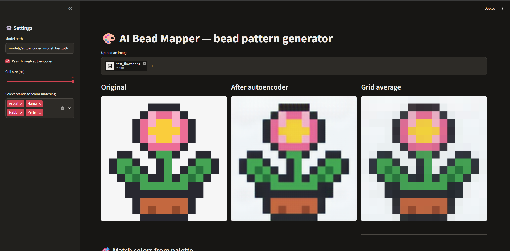
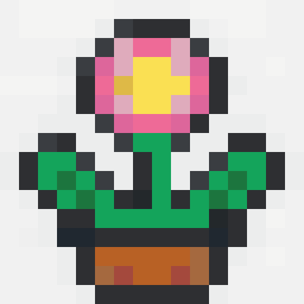
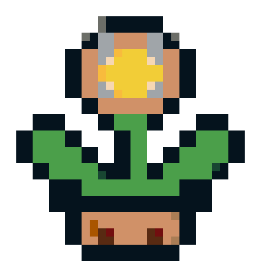

# Bead Mapper

Turn any image into a printable bead pattern (Perler, Hama, Artkal, Nabbi, LEGO).

Bead Mapper combines a small convolutional autoencoder (PyTorch, U-Net-style skip connections) with grid averaging and perceptual colour matching. Upload a picture in the Streamlit app and get a bead map, a bead count per colour and a numbered PDF pattern.

Team project (2 students) for the course *Deep Learning*, M.Eng. Telematics, TH Wildau, winter semester 2025/26.
Idea, model, training pipeline, app and testing: **Erik Starodubtsev**. Presentation and report: Xeniya Zabaranilova.



| Bead brands (Artkal, Hama, Nabbi, Perler) | LEGO only |
|---|---|
|  |  |

Test image: `examples/test_flower.png` (16 × 16 pixel art, cell size 32 px). Exported PDFs and colour lists for both runs are in `examples/`.

## How it works

```
Input image → Autoencoder (optional) → Grid averaging → Colour matching (LAB + KD-tree) → Bead pattern
```

1. **Autoencoder (optional).** The image is resized to 128 × 128 and passed through a convolutional autoencoder that smooths colours and reduces noise. Skip connections between encoder and decoder keep edges and fine details. The result is scaled back to the original size.
2. **Grid averaging.** The image is split into square cells (4–32 px); each cell becomes one bead with the cell's average colour.
3. **Colour matching.** Every cell colour is converted to the CIELAB colour space and matched to the nearest real bead colour with a KD-tree (scikit-learn). LAB distances are closer to how people perceive colour differences than RGB distances.
4. **Output.** The app shows each stage and exports the pattern as PNG, a colour list with bead counts as CSV, and a numbered pattern with a legend as PDF.

### Model and training

- **Architecture** (`src/models/autoencoder.py`): encoder with 4 strided convolution blocks (128 → 8 px, 256 channels in the bottleneck), decoder with 4 upsampling blocks and concatenated skip connections. A lighter variant is available for faster training.
- **Loss** (`src/losses/perceptual_loss.py`): weighted sum of MSE, an edge loss (difference of image gradients, penalises blur) and a colour-consistency term. Optionally a VGG16 feature loss.
- **Data:** STL-10 (5,000 training images, test split for validation), downloaded automatically by torchvision.
- **Training** (`train_autoencoder.py`): Adam, `ReduceLROnPlateau` scheduler, the checkpoint with the lowest validation loss is saved as `*_best.pth`.

A trained model is included in `models/autoencoder_model_best.pth`, so the app runs without training.

## Quick start (Windows, PowerShell)

Requires Python 3.10–3.12.

```powershell
cd bead-mapper
python -m venv .venv
.\.venv\Scripts\Activate.ps1
pip install -r requirements.txt
streamlit run app.py
```

The app opens at http://localhost:8501.

If PowerShell blocks the activation script, run once:
`Set-ExecutionPolicy -Scope CurrentUser RemoteSigned`

Linux / macOS / WSL: use `source .venv/bin/activate` instead of the `Activate.ps1` line.

## Using the app

1. Upload a PNG or JPG image.
2. In the sidebar choose the cell size (smaller = more detail and more beads), the bead brands you own, and whether to use the autoencoder.
3. Compare the stages: original → after autoencoder → grid average → bead map.
4. Download the pattern as PNG, CSV or PDF (see `examples/`).

Autoencoder **on** gives smoother colour areas with less noise; **off** keeps the image closer to the original.

## Known limitations

- **Cell size should match the source image.** If the grid does not line up with the image's own pixels, border cells average two colours and produce in-between shades (light halos around dark outlines). For pixel art, choose a cell size equal to its pixel size.
- **The result depends on the palette.** The nearest colour is always taken from the selected brands. LEGO has no pink, so the pink petals in the example become greys and Nougat tones.
- **Similar colours from several brands.** With all brands selected, nearly identical whites or blacks from different brands can appear in one pattern, because each cell picks its own nearest match.
- **The autoencoder works at 128 × 128 px**, so very small details in large images can be softened.

## Training your own model

```powershell
python train_autoencoder.py
```

The first run downloads STL-10 (about 2.6 GB) into `data/`. Training runs on a CUDA GPU if available, otherwise on the CPU (much slower). Settings are read from environment variables:

| Variable | Default | Meaning |
|---|---|---|
| `EPOCHS` | 200 | number of epochs |
| `BATCH_SIZE` | 64 | batch size (reduce if out of memory) |
| `LR` | 0.001 | learning rate |
| `LOSS_TYPE` | `perceptual` | `perceptual`, `vgg` or `mse` |
| `USE_LIGHTWEIGHT` | `false` | smaller, faster model |
| `MODEL_PATH` | `models/autoencoder_model.pth` | where the final model is saved |

Example for a short test run in PowerShell:

```powershell
$env:EPOCHS = "50"; python train_autoencoder.py
```

## Project structure

```
app.py                      Streamlit interface
train_autoencoder.py        training script
src/models/autoencoder.py   autoencoder architectures
src/losses/perceptual_loss.py  loss functions
src/inference.py            model loading, autoencoding, grid averaging, palette mapping
src/color_mapping.py        LAB conversion and KD-tree palette lookup
src/utils.py                colour report, legend, PDF export
data/palettes/palette.csv   1,146 bead colours (brand, code, name, RGB)
models/                     trained model
examples/                   test image, exported PDFs and colour lists
images/                     screenshots for this README
```

## Tech stack

Python · PyTorch / torchvision · NumPy · pandas · scikit-learn · scikit-image · Pillow · Streamlit · ReportLab

## Credits

- U-Net: Ronneberger et al., 2015 · perceptual loss: Johnson et al., 2016 · STL-10: Coates et al., 2011
- Bead colour data compiled from community colour files shared in [r/beadsprites](https://www.reddit.com/r/beadsprites/comments/7ebgal/xml_files_of_all_the_colors_hama_perler_nabbi/). Colour values are approximate.

## License

MIT, see [LICENSE](LICENSE).
